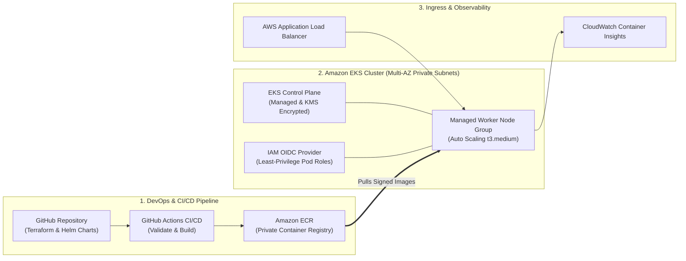

# Production Amazon EKS (Kubernetes) & Microservices CI/CD (Terraform)

Infrastructure as Code (IaC) template provisioning a production-ready **Amazon EKS Kubernetes cluster** with managed worker node groups, IAM OIDC provider for IRSA (IAM Roles for Service Accounts), KMS secrets encryption, and automated GitHub Actions CI/CD validation.

## Architecture Overview



## Key Production Features
- **Zero-Trust Pod Security (IRSA):** Configures an IAM OpenID Connect (OIDC) provider so Kubernetes pods assume fine-grained IAM roles without static AWS credentials.
- **Envelope Encryption:** Encrypts Kubernetes secrets at rest using a dedicated customer-managed AWS KMS key with automatic rotation.
- **Private Container Registry:** Provisions an Amazon ECR repository with automatic image vulnerability scanning on push and lifecycle cleanup rules.
- **Auto-Scaling Compute:** Deploys Multi-AZ managed node groups with automated scaling guardrails and CloudWatch control-plane logging enabled.

## Quick Start

```bash
# 1. Initialize Terraform providers
terraform init

# 2. Preview EKS cluster and ECR infrastructure
terraform plan -var="cluster_name=prod-microservices-eks"

# 3. Deploy EKS infrastructure
terraform apply -auto-approve
```
